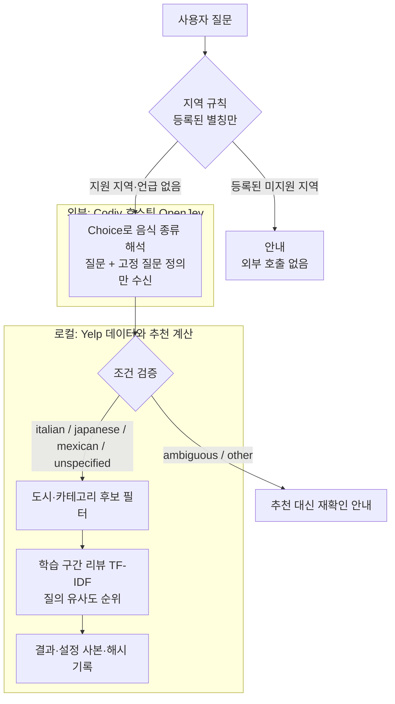
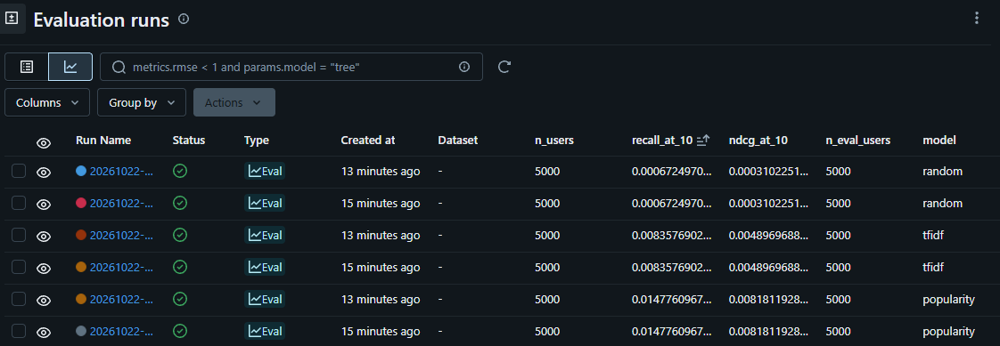
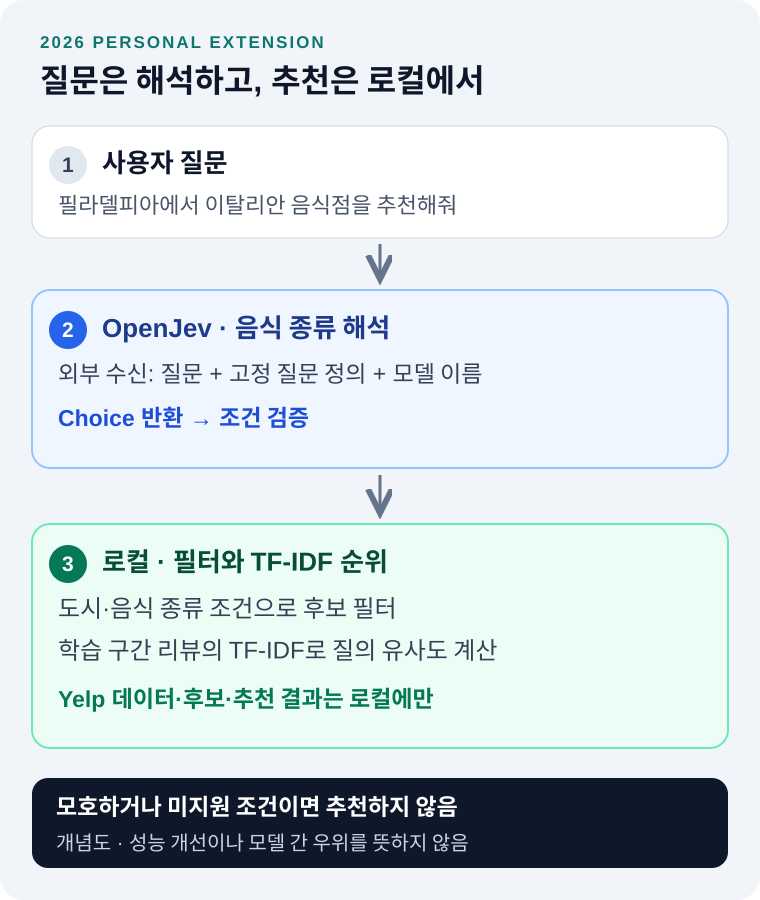
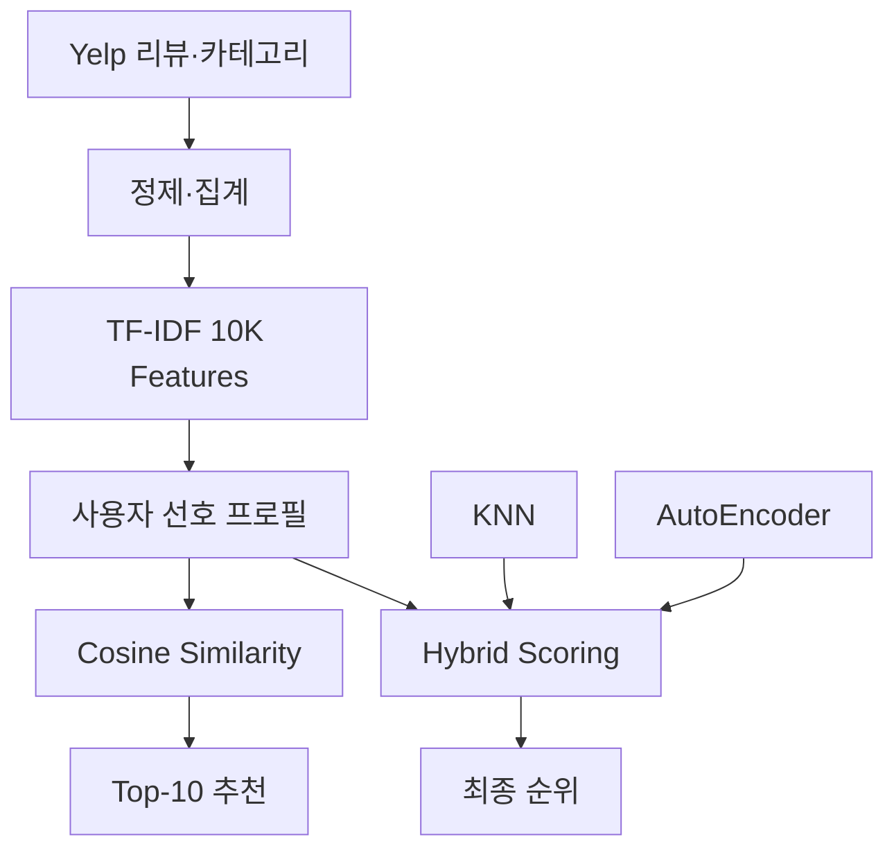
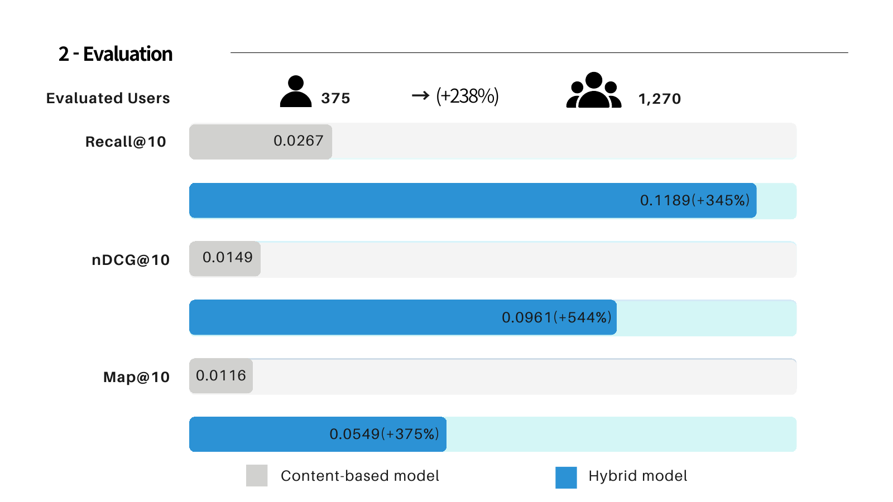

# Restaurant Recommendation System

<p align="center">
  
</p>

> Yelp 리뷰로 사용자 취향을 표현하고 OpenTable 데이터에서 전이 성능을 확인한 머신러닝 팀 프로젝트(2025)입니다. 이후 개인적으로 평가 구조를 다시 점검하고, 자연어 질문을 받아 로컬에서 추천하는 파이프라인으로 확장했습니다(2026).

## 핵심 요약

- **문제**: 2025년에 담당한 TF-IDF 추천 코드를 다시 점검했습니다. 데이터 분할 전에 전체 리뷰로 TF-IDF와 음식점 문서를 만들어, 평가 정답 리뷰가 학습 입력에 섞이는 누수가 있었습니다. 또 "마지막 리뷰"가 날짜 기준이 아니었습니다.
- **검토와 선택**: 리뷰 원문을 외부 AI로 분류하는 방식은 데이터 이용 조건을 검토한 뒤 보류했습니다. 대신 외부 AI에는 **사용자 질문의 음식 종류 해석**만 맡기고, 데이터와 추천 계산은 로컬에 두는 구조를 골랐습니다. 필요한 판단이 문장 생성이 아니라 고정된 선택지 해석이었기 때문에, 라벨과 선택지별 확률을 돌려주는 OpenJev(System One Choice)를 썼습니다.
- **접근**:
  - Pennsylvania 음식점 표본과 전역 시간 분할로 인기순·TF-IDF·무작위 기준선을 같은 조건에서 다시 만들었습니다.
  - 질문 → 해석 → 로컬 필터 → 학습 구간 TF-IDF 순위로 이어지는 흐름을 구현했습니다.
- **결과**:
  - 검증 구간 평가 사용자 5,000명에서 인기순 > TF-IDF > 무작위였고, 두 번 실행해 같은 결과를 얻었습니다.
  - 질문 3개로 한 실제 연결에서 기대한 조건이 반환됐고, 그 조건이 로컬 필터에 반영됐습니다. 모호한 질문은 추천하지 않고 다시 묻는 상태를 돌려줬습니다.
- **가치와 한계**:
  - 실행마다 설정·코드·데이터 해시를 남겨 결과를 추적할 수 있게 했습니다.
  - 인기순이 앞선 예상 밖 결과를 해석하려고 두 가지 관찰 분석을 실행했습니다. 평가 정답 쌍의 약 36%가 학습 기간 인기 상위 10% 음식점에 몰려 있었고, 긍정 이력이 짧은 구간에서 격차가 가장 크지는 않았습니다. 원인 후보는 좁혔지만 인과는 확정하지 않았습니다.
  - 질문 해석 정확도 평가는 남은 과제입니다.

자세한 근거와 판단 과정은 [docs/PROJECT_STORY.md](docs/PROJECT_STORY.md)에 있습니다.

## 현재 파이프라인 (2026 개인 확장)



- 외부로 보내는 것은 모델 이름, 사용자 질문(질문에 직접 쓴 지명 포함), 고정 질문 정의뿐입니다.
- Yelp 리뷰, 음식점·카테고리 목록, 후보, 추천 결과는 로컬에만 둡니다.
- 지역은 설정에 등록된 별칭만 인식합니다. 그래서 등록되지 않은 지명(예: Boston)은 지역 언급이 없는 것과 같게, Pennsylvania 전체 후보로 처리됩니다.

## 2026 개인 확장 결과

이 결과는 아래 2025 팀 프로젝트 기록과 데이터 범위·분할·정답 정의가 달라서, 두 결과를 직접 비교하거나 개선율을 계산하지 않습니다.

**검증 기준선**
- 조건: Pennsylvania 음식점, 학습 구간 2021-01-01 이전, 검증 구간 2021-01-01 ~ 2021-06-30, 같은 평가 사용자 5,000명
- 정답: 검증 기간에 리뷰한 음식점 중 이전 이력에 없고 학습 후보에 있는 음식점 집합. 바로 다음에 방문할 한 곳을 맞히는 평가가 아닙니다.

| 모델 | Recall@10 | nDCG@10 |
|---|---:|---:|
| 인기순 | 0.0147761 | 0.0081812 |
| TF-IDF | 0.0083577 | 0.0048970 |
| 무작위 | 0.0006725 | 0.0003102 |

두 번 실행해 지표, 평가 사용자 목록, 설정·코드·데이터 해시가 모두 같았습니다.

<p align="center">
  
</p>
<p align="center"><sub>B1 검증 기준선의 모델별 2회 실행 기록(로컬 MLflow). 같은 평가 사용자 5,000명에서 모델별 지표가 일치했습니다. OpenJev 호출 기록이나 추천 품질 개선을 보여 주는 화면은 아닙니다.</sub></p>

인기순이 더 높게 나온 원인은 아직 확정하지 않았습니다. 코드에서 확인한 구조는 다음과 같습니다.
- 정답에는 별점 제한이 없습니다.
- TF-IDF 프로필은 긍정 이력을 같은 비중으로 평균합니다.

이 구조를 바탕으로 원인 후보를 정리하고, 재학습 없이 저장된 결과로 관찰 분석 두 가지를 실행했습니다(관찰, 인과 미확정).
- **정답의 인기도 분포**: 후보 12,351곳 중 학습 기간 인기 상위 10%(1,236곳)에 평가 정답 쌍의 36.02%, 상위 20%(2,471곳)에 52.83%가 있었습니다.
- **긍정 이력 길이별**: 1곳 / 2~4곳 / 5곳 이상 세 구간 모두 인기순이 높았고, Recall 격차는 0.0056 → 0.0038 → 0.0089로 5곳 이상에서 가장 컸습니다. 서로 다른 사용자 집단의 비교이며, 이력 부족만으로는 설명하기 어렵습니다.

자세한 표와 해석은 [PROJECT_STORY §7](docs/PROJECT_STORY.md#7-실행-결과)에 있습니다. 통계 검정과 테스트 구간 평가는 하지 않았습니다.

**질문 해석 → 로컬 추천 실제 연결**
- 응답 모델 `openjev-0.1`, 요청 3회, 재시도 0회, 입력 토큰 합계 658

| 질문 | 해석 (기대) | 지연 | 로컬 결과 |
|---|---|---:|---|
| 필라델피아에서 이탈리안 음식점을 추천해줘 | italian (italian) | 1,313 ms | 후보 496곳 → 10곳 |
| Looking for a quiet sushi dinner place in Philly | japanese (japanese) | 1,500 ms | 후보 285곳 → 10곳 |
| 필라델피아에서 이탈리안이나 멕시칸 아무거나 괜찮아 | ambiguous (ambiguous) | 797 ms | 추천 대신 조건 재확인 |

- 이 3개는 연결 확인용 질문이며, 분류 정확도를 검증한 것이 아닙니다.
- 지연에는 네트워크 시간이 포함됩니다.
- 추천 목록의 품질은 평가하지 않았습니다.

### OpenJev의 역할과 데이터 경계

<p align="center">
  
</p>
<p align="center"><sub>현재 구현 범위를 설명하기 위해 직접 제작한 개념도입니다. 공식 로고·제품 화면·실험 결과 이미지가 아닙니다. 세부 지역 규칙과 분기 조건은 위 Mermaid 구조도와 본문을 참고하세요.</sub></p>

<details>
<summary>Jev / OpenJev를 고른 이유</summary>

"다른 모델보다 정확해서" 고른 것이 아닙니다.

- **공식 문서상 특징** (2026-10-22 조회):
  - System One 모델은 문장을 생성하지 않고, 정해진 형식의 질문에 라벨과 선택지별 확률로 답합니다. 문서는 분류·라우팅 같은 용도를 제시합니다.
  - `openjev-0.1`은 정해 둔 답 칸의 확률 분포를 denoising step에서 읽는 방식입니다. 불확실하면 추가로 읽어 평균합니다.
  - 제공자가 말하는 "모델 시간"은 이 프로젝트가 잰 네트워크 포함 지연과 다른 측정값입니다.
- **이 프로젝트와 맞은 이유**:
  - 필요한 일은 질문의 음식 종류를 고정된 선택지로 해석하는 것이었고, 반환 라벨을 로컬 카테고리 필터에 바로 연결할 수 있었습니다.
  - 모델 학습 없이 질문·선택지 정의와 API 호출만으로 연결했습니다.
  - 기존 TF-IDF는 그대로 두었고, Yelp 데이터와 추천 결과는 외부로 보내지 않았습니다.
- **실제로 확인한 것** (질문 3개):
  - 세 질문 모두 기대한 라벨이 나왔습니다.
  - 그 라벨이 로컬 필터에 반영됐습니다.
  - 모호한 질문은 추천하지 않고 다시 확인하도록 처리했습니다.
  - 요청 3회, 재시도 0회, 입력 658토큰, 네트워크 포함 지연은 0.8~1.5초였습니다.
- 구조화된 반환은 일반 LLM의 구조화 출력으로도 얻을 수 있습니다. 다른 모델과는 비교하지 않았으므로 속도·비용·정확도가 더 낫다고 주장하지 않습니다. 자세한 내용은 [PROJECT_STORY §5](docs/PROJECT_STORY.md#5-jev--openjev를-고른-이유)에 있습니다.

</details>

## 2026 점검에서 발견한 문제와 설계 선택

| 발견 | 조치 |
|---|---|
| 분할 전에 전체 리뷰로 TF-IDF·음식점 문서를 만들어, 평가 정답 리뷰가 학습 입력에 섞임 (사용자 프로필이 평균하는 벡터도 포함) | 전역 시간 분할을 먼저 하고, 문서·어휘·IDF·프로필·인기순을 모두 학습 구간 리뷰로만 계산 |
| "마지막 리뷰"가 `user_id` 정렬 후 `tail(1)`이라 날짜 기준이 아님. `date`·`review_id`도 전처리에서 빠짐 | `review_id`·`date`를 보존하고, 경계 시각과 같은 리뷰는 뒤 구간에 넣는 규칙을 고정 |
| 평가 사용자 선택에 seed가 없어 다시 실행하면 결과가 달라질 수 있음 | seed를 고정하고 평가 사용자 목록·해시를 저장 |
| 비교할 기준선이 없음 | 인기순·무작위를 추가하고, 같은 사용자·후보·방문 제외 규칙으로 비교 |
| zip 안의 `.tar`가 실제로는 gzip이라 첫 실행이 실패 | 앞 바이트로 압축 형식을 판별해 스트리밍으로 읽음 |

외부 AI 활용 방식으로는 세 가지를 검토했습니다: 리뷰 속성 분류(코드·합성 시험까지 작성, 실제 리뷰 전송은 보류), 로컬 소형 모델(설치가 필요해 시도하지 않음), 사용자 질문 해석(채택). 자세한 내용은 [PROJECT_STORY §4](docs/PROJECT_STORY.md#4-외부-ai를-어디에-쓸지-검토한-후보와-선택)에 있습니다.

## 실행 방법

Yelp Open Dataset은 저장소에 포함하지 않습니다. 이용 조건을 확인한 뒤 직접 내려받아 `configs/baseline.yaml`의 `data.zip_path`에 경로를 지정해야 합니다.

```bash
python -m pip install -r requirements.txt
python -m pytest                                                     # 합성 자료 시험
python -m src.prepare_data --config configs/baseline.yaml            # PA 음식점 표본 생성
python -m src.run_baseline --config configs/baseline.yaml            # 검증 기준선 (MLflow는 선택)
python -m src.analyze_baseline --run artifacts/runs/<run_id>            # 기준선 결과 해석용 관찰 분석
python -m src.query.run_query --config configs/query_demo.yaml --mode local \
  --question "Looking for a quiet italian dinner in Philly" --condition italian   # API 없이 로컬 추천만
```

외부 질문 해석(`--mode connection-check`)을 쓰려면 다음이 필요합니다.
- 환경변수 `TYPESAFE_BASE_URL`, `TYPESAFE_API_KEY`
- 설정 파일의 승인 플래그
- 누적 요청 상한

API 키는 환경변수로만 받고 로그·결과에 남기지 않습니다.

| 경로 | 내용 |
|---|---|
| `src/prepare_data.py`, `src/split.py` | zip 스트리밍 표본 생성, 전역 시간 분할, 누수 검사 |
| `src/baselines.py`, `src/metrics.py`, `src/run_baseline.py` | 기준선 3종, Recall·nDCG, 실행 기록(MLflow 선택) |
| `src/analyze_baseline.py` | 저장된 기준선 결과의 관찰 분석(정답 인기도 집중, 긍정 이력 길이별 격차) |
| `src/query/` | 질문 해석 → 로컬 필터 → TF-IDF 순위 |
| `src/aspects/` | 리뷰 속성 분류(보류된 경로)와 공통 API 클라이언트 |
| `configs/`, `tests/` | 실행 설정, 합성 자료 시험 |
| `tfidf_main.py`, `preprocessing.py`, `load_data.py` | 2025 팀 프로젝트 당시 원본 코드 (변경하지 않음) |

## 한계와 후속 과제

- 기준선:
  - 인기순이 앞선 원인은 확정하지 않았습니다. 긴 이력의 평균 프로필 희석, 구간별 정답 구성 차이, 기존 방문 음식점 제외의 영향은 미검증 후속 후보입니다.
  - 통계 검정과 테스트 구간 평가는 하지 않았습니다.
- 질문 해석:
  - 질문 3개로 연결만 확인했습니다. 직접 작성한 질문 세트와 사람 정답으로 키워드 방식과 비교하는 평가는 후속 과제입니다.
  - 음식 종류는 3가지, 지역은 등록된 별칭만 다룹니다.
- 리뷰 속성 분류: 실제 리뷰 적용은 데이터 이용 조건 때문에 보류 중입니다.
- 질문 기반 추천 목록의 품질은 평가하지 않았습니다.

---

## 2025 팀 프로젝트 기록

아래는 2025 팀 프로젝트 당시 기록입니다. 수치는 **과거 보고**이며 이번에 재현하지 않았습니다. 이후 점검에서 평가 누수가 확인되어, 이 수치는 위 2026 결과와 비교하지 않습니다.

### 프로젝트 설명

리뷰·카테고리처럼 설명 가능한 콘텐츠 정보와 사용자 행동 신호를 결합해 레스토랑을 추천했습니다. 개인 담당 모델인 TF-IDF 콘텐츠 추천을 기준선으로 구축하고, 팀의 KNN·AutoEncoder 결과와 결합해 데이터 희소성과 cross-domain 문제를 개선하는 과정을 실험했습니다.

### 주요 기능과 모델

- Yelp 비즈니스·리뷰 데이터 전처리
- 레스토랑별 리뷰와 카테고리의 TF-IDF 벡터화
- 긍정 평가 항목을 평균한 사용자 취향 프로필 생성
- 코사인 유사도 기반 Top-10 추천
- OpenTable 데이터로 zero-shot 전이 평가
- TF-IDF·KNN·AutoEncoder 점수를 결합한 하이브리드 추천
- Recall@10, nDCG@10, MAP@10 기반 비교

### 추천 파이프라인 (2025)



### 개인 담당: TF-IDF 추천

- `business_id`별 리뷰·이름·카테고리를 하나의 문서로 구성
- `max_features=10,000`, unigram(`ngram_range=(1,1)`), `float32` 기반 희소 행렬 생성 (기존 README의 "unigram·bigram" 표기는 코드와 달라 정정)
- 선호 평점 이상의 레스토랑 벡터를 평균해 사용자 프로필 구축
- 사용자 프로필과 아이템 행렬의 내적으로 추천 점수 계산
- 마지막 리뷰 1건을 기준으로 오프라인 Top-K 평가 (날짜 기준이 아니었다는 점은 [2026 점검](#2026-점검에서-발견한-문제와-설계-선택) 참고)
- Yelp에서 학습한 벡터를 OpenTable에 적용해 카테고리 적합도 확인

### 개발 과정과 문제 해결

1. 약 15만 개 비즈니스(음식점 외 업종 포함)와 대규모 리뷰를 정제해 아이템 문서를 구성했습니다.
2. 30,000개 feature 설정에서 메모리 부족이 발생해 10,000개로 축소했습니다.
3. `numpy.matrix` 호환 오류를 `ndarray` 변환과 reshape로 해결했습니다.
4. dense 변환을 줄이고 CSR 희소 연산, 사용자 샘플링, 후보 제한을 적용했습니다.
5. TF-IDF 기준선을 평가한 뒤 팀의 KNN·AutoEncoder와 가중 결합했습니다.

### 주요 결과 (과거 보고)

| Model | Evaluated users | Recall@10 | nDCG@10 | MAP@10 |
|---|---:|---:|---:|---:|
| TF-IDF baseline | 375 | 0.0267 | 0.0149 | 0.0116 |
| Hybrid | 1,270 | 0.1189 | 0.0961 | 0.0549 |

<details>
<summary>2025 발표 자료의 평가 이미지 (과거 보고)</summary>

<p align="center">
  
</p>
<p align="center"><sub>2025 팀 프로젝트 당시 발표 자료의 원본입니다. 위 표와 같은 과거 보고이며, 이번에 재현하지 않았습니다. 모델마다 평가 사용자와 조건이 달라 동일 조건의 개선율로 해석할 수 없습니다.</sub></p>

</details>

TF-IDF는 OpenTable 카테고리 적합도 기준 `Category-Hit@10 ≈ 0.41`을 기록했습니다. 단독 모델의 순위 지표는 낮았지만, 텍스트 기반 선호 신호가 다른 도메인에도 일부 일반화됨을 확인했고 하이브리드 모델의 입력으로 활용했습니다.

## 저장소와 기여 범위

이 저장소는 팀 프로젝트를 바탕으로 개인적으로 확장한 저장소입니다(팀 저장소에서 fork해 시작). 원본 팀 저장소는 `ML-team12/ML-recommendation`이며, 본 README는 개인 담당인 TF-IDF 모델과 팀 전체 결과를 구분해 설명합니다.

- 2025: 개인 담당은 TF-IDF 콘텐츠 기반 모델입니다. KNN·AutoEncoder·하이브리드는 팀 결과입니다.
- 2026: 평가 점검, 기준선 재구성, 질문 해석 → 로컬 추천 확장은 개인 작업입니다.
  - AI 코딩 도구(Claude Code)로 구현하고 다른 AI 도구(Codex)로 검수했습니다.
  - 실행과 주요 결정은 직접 했습니다.
  - 프로그램 안에 스스로 실험하는 에이전트를 구현한 것은 아닙니다.

## 프로젝트 범위 및 유의사항

- 2025 팀 프로젝트의 코드와 결과는 팀 공동 작업이며, 2026 개인 확장은 위 기여 범위와 구분합니다.
- 공개 저장소이지만 별도의 오픈소스 라이선스가 없다면 코드 재사용·재배포가 자동으로 허용되는 것은 아닙니다.
- Yelp·OpenTable 원본 데이터와 26GB 이상의 전처리·모델 산출물은 용량 및 사용 조건 때문에 포함하지 않았습니다.
- 2026 확장의 실행 산출물(추천 목록, 응답 원문, 로그)도 저장소에 포함하지 않습니다.
- 발표 자료의 이름·학번 등 개인 정보는 저장소에서 제외했습니다.
- 지표는 제한된 평가 사용자와 특정 분할에서 얻은 수업용 실험 결과로 실제 서비스 품질을 보장하지 않습니다. (2026 확장 결과도 제한된 표본·분할에서 얻은 실험 결과입니다.)
- 추천 결과는 편향되거나 부정확할 수 있으며 상업적 추천 시스템으로 검증된 모델이 아닙니다.
